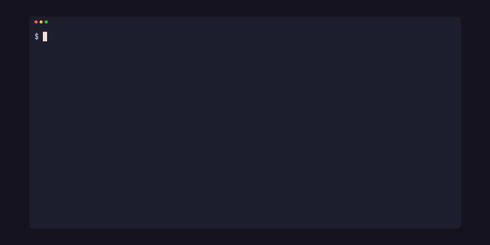
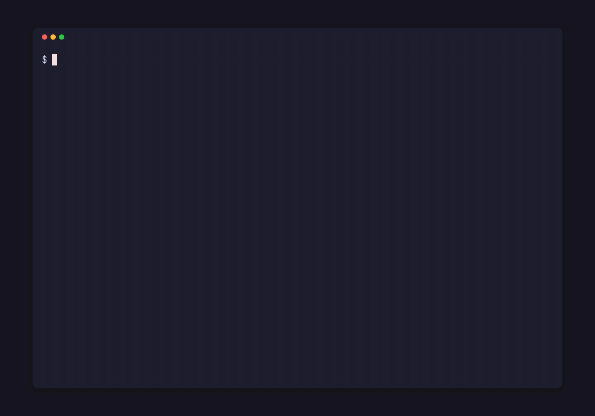

<p align="center"></p>

# pfx-scene

[](https://github.com/gmrdad82/pfx-scene/actions/workflows/ci.yml) [](https://github.com/gmrdad82/pfx-scene/tags)

One TOML format for 3D scenes, prefabs and material libraries, shared by a game engine and a 3D editor, so a scene saved in one opens in the other. It is the content format of [pfx](https://github.com/gmrdad82/pfx), the [PITO MD](https://pitomd.com) game and render engine, and of its editor; this crate reads, checks, resolves, edits and migrates it.

- **Fast:** resolves a 1,000-object scene in 25 ms and checks its whole project in 28 ms; a 100-object scene takes 3 ms for either.
- **Small:** four dependencies (`serde`, `toml`, `toml_edit` and this repository's `manf`; 21 crates in the whole tree), no unsafe code, about 14,700 lines of Rust with `manf`.
- **Exact:** every mistake is reported at its file, line and column with a stable code, and every edit keeps the author's comments, spacing and key order.

Works on Linux, Windows and macOS (CI-tested on all three).

It is for the tools on either side of a scene file: an engine's loader, an editor that saves what a person arranges, a build tool that emits scenes, and a text editor that marks mistakes as someone types.

## Install and first use

Add it to a Rust project, on Linux, Windows or macOS:

```toml
[dependencies]
pfx-scene = { git = "https://github.com/gmrdad82/pfx-scene", tag = "v1.0.1" }
```

Or try it on the demo project first, with a stable Rust toolchain:

```sh
git clone https://github.com/gmrdad82/pfx-scene && cd pfx-scene
cargo run --release --example scene-check -- examples/demo
```

The shortest useful program opens a project, prints every finding and resolves its scene:

```rust,no_run
use std::path::Path;

let project = pfx_scene::Project::open(Path::new("my-game")).unwrap();
for diagnostic in project.check() {
    println!("{diagnostic}");
}
let scene = project.scene(Path::new("scenes/room.scene.toml")).unwrap();
println!("{} objects", scene.objects.len());
```

## The format

A project is a folder with a `project.toml`, and every file in it is plain TOML that starts with `format = 1`. This is the demo's scene, shortened:

```toml
format = 1
materials = ["materials/room.materials.toml"]

[mesh.ball]
id = "ttfwjw4wnm"
file = "assets/ball.gltf"

[[object]]
id = "j66hkn5wx4"
name = "lamp"
mesh = "ball"
material = "brass"
at = [0.0, 2.4, 0.0]
scale = 0.3

# Two crates from one prefab; the second is turned and lighter.
[[object]]
id = "axxz3n1hcj"
name = "right crate"
prefab = "prefabs/crate.prefab.toml"
at = [1.2, 0.5, 0.3]
rotate = [0.0, 30.0, 0.0]

[object.set]
"box.body.density" = 0.5
```

Scenes (`*.scene.toml`), prefabs (`*.prefab.toml`), material libraries (`*.materials.toml`) and collision proxies (`*.proxies.toml`) cover meshes, lights, materials, the sky, sun, haze, camera and render settings, rigid bodies, character controllers, trigger volumes, camera rigs, collision layers, glTF animation clips, sprite atlases, tile layers, and a game's tunables with their ranges. Assets are standard files referenced by path: glTF 2.0, PNG, WAV or Ogg Vorbis, TTF or OTF, Radiance HDR. [docs/format.md](docs/format.md) specifies every key, its type, default and range.

## Errors at file, line and column

The clip at the top: `Project::check` checks a whole project and `check` checks one unsaved buffer against it, so a text editor can mark mistakes as someone types. Each finding has a file, a line, a column, an end, a stable code (`bad-reference`, `path-case`, `missing-key` and the rest, listed in the spec) and, where it helps, the other place involved. A misspelt material, a path whose case differs from the disk, a key of the wrong type, an id used twice and a reference to nothing are each one finding, at the exact text.

## Prefabs, overrides and stable ids

<p align="center"></p>

`Project::scene` resolves a scene: includes merged, prefabs placed as objects with their per-placement overrides (`[object.set]`), and every reference rewritten to the key of the entry it names. A placed entry's key and id are namespaced by its placement (`right crate/box`, `axxz3n1hcj/6dek3mm9mh`), so two placements of one prefab never collide. References go by id, with names as labels, so a rename or a move never breaks them. Includes and prefabs nest up to 64 deep, and a cycle is refused with its chain of files.

## A careful writer

<p align="center"></p>

`SceneEdit` edits a scene's files in place. A changed value keeps its place, its neighbours, the comments and the number spelling, so a diff shows only what changed. An edit the checker would refuse is refused before anything is written. Edits group into undo and redo steps by exact text, and `dry_run` computes an edit's patches without writing.

## Versioned files

<p align="center"></p>

Every file names its format version. An older file is read through an in-memory migration, with its findings pointing into the file as written, and `Project::migrate` rewrites it on disk through the same writer. A newer file than the crate knows is refused with the version it knows.

## Speed


| Objects in the scene | 100 | 1,000 | 10,000 |
|---|---|---|---|
| Scene file size | 14 KB | 144 KB | 1.4 MB |
| `Project::check`, the whole project | 3.2 ms | 27.7 ms | 418 ms |
| `Project::scene`, resolve | 2.8 ms | 25.4 ms | 360 ms |
| `check`, an unsaved buffer | 2.8 ms | 33.0 ms | 432 ms |
| `SceneEdit::open` | 6.2 ms | 44.6 ms | 664 ms |
| One `set_at`, checked and written | 5.9 ms | 122 ms | 990 ms |

How it was measured: `cargo run --release --example scene-bench -- tmp/bench 100 1000 10000`, which writes a project per size (one scene file, a quarter of its objects prefab placements with an override, a quarter with rigid bodies, 32 materials, ids filled by `Project::fix`) and prints the median of 7 runs of each step. Measured once on 2026-10-14 on an AMD Ryzen 9 9950X under Linux with Rust 1.97.1, while the machine was busy with other work; nothing was re-run. The times grow faster than the object count from 1,000 objects up.

## The API

```rust,no_run
use std::path::Path;

use pfx_scene::{Project, SceneEdit, Target, check};

let project = Project::open(Path::new("my-game")).unwrap();
for diagnostic in project.check() {
    println!("{diagnostic}");
}

let scene = project.scene(Path::new("scenes/room.scene.toml")).unwrap();
for object in &scene.objects {
    println!("{} at {:?}", object.key, object.value.at);
}

let buffer = std::fs::read_to_string("my-game/scenes/room.scene.toml").unwrap();
let marks = check(&buffer, Path::new("scenes/room.scene.toml"), &project);
println!("{} marks for the editor", marks.len());

let mut edit = SceneEdit::open("my-game/scenes/room.scene.toml").unwrap();
edit.set(&Target::Object("crate".into()), &["at"], [0.0, 0.5, 1.0]).unwrap();
edit.undo().unwrap();

let migrated = project.migrate(Path::new("scenes/old.scene.toml")).unwrap();
std::fs::write("my-game/scenes/old.scene.toml", migrated).unwrap();
```

- `Project::check` checks every file of a project; `check` checks one unsaved buffer against it.
- `Project::scene` resolves a scene; `Project::read` returns one file as its typed data, plain serde structs.
- `SceneEdit` edits a scene's files in place, refusing any edit that the checker would refuse; `dry_run` computes an edit's patches without writing.
- `Project::scene_with` and `check_with` resolve and check with unsaved texts in place of the files.
- `Project::fix` fills the ids a scene's files lack.
- `Project::migrate` rewrites an older file as the current format.
- `pack` puts a scene and every file it reads into one `.manf` file, the same bytes every time; `unpack` writes them back out. `Project::open_manf` opens one, and checks, resolving and `SceneEdit` work on the TOML inside it in place.

The examples in [examples/](examples/) are small programs on this API: `scene-check` checks a project or a `.manf` scene, `scene-tree` prints a resolved scene, `scene-write` moves, renames, sets a material or migrates a file, `scene-pack` packs a scene into a `.manf` and unpacks one, and `scene-bench` measures the table above. What changed in each version is in [CHANGELOG.md](CHANGELOG.md).

## The .manf container

The repository also holds `manf` ([manf/](manf/README.md)), the crate for `.manf` files: one file of named chunks (a scene's TOML files, its glTF, the files it names, a thumbnail), each checksummed and stored or compressed on its own with LZ4 or deflate, so a reader decodes only the chunks it needs and borrows stored ones without a copy. A reader refuses a cut, oversized or corrupt file with an error, never a panic, and the writer gives the same bytes for the same chunks. Its only dependency is miniz_oxide; its LZ4 and CRC-32 are ported from lz4_flex and crc32fast. It pins the same way:

```toml
[dependencies]
manf = { git = "https://github.com/gmrdad82/pfx-scene", tag = "v1.0.1" }
```

## Part of PITO MD

pfx-scene is one of the [PITO MD](https://pitomd.com) tools. [pfx](https://github.com/gmrdad82/pfx), the game and render engine with its scene editor, and [Manfred](https://github.com/gmrdad82/manfred), the scene builder and viewer, keep their scenes in this format and depend on this crate. The clips here were recorded with [prec](https://github.com/gmrdad82/prec) and made into GIFs with pcod from [pito-codecs](https://github.com/gmrdad82/pito-codecs), and the chart was drawn by [pito-compare](https://github.com/gmrdad82/pito-compare).

## Build and test

A stable Rust toolchain (edition 2024) and [cargo-nextest](https://nexte.st) are all it needs.

```sh
bin/gate          # rustfmt, clippy with no warnings, every test and the doc tests
bin/gate --fast   # what CI runs on every push and pull request; the same checks while the crate is small
```

## Contributing

Issues and pull requests are welcome. Please read the [code of conduct](CODE_OF_CONDUCT.md) first, and report security problems as [SECURITY.md](SECURITY.md) says. A change to the format changes [docs/format.md](docs/format.md) with it, and `bin/gate` passes before a pull request.

## Licence


The code is MIT licensed: see [LICENSE](LICENSE). The MIT grant covers the code only: the PITO MD name and every app and game name and logo stay Catalin Ilinca's, all rights reserved, as [TRADEMARKS.md](TRADEMARKS.md) says. Where the format and the first code came from is in [NOTICE.md](NOTICE.md).
